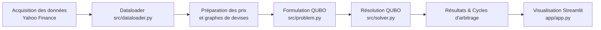
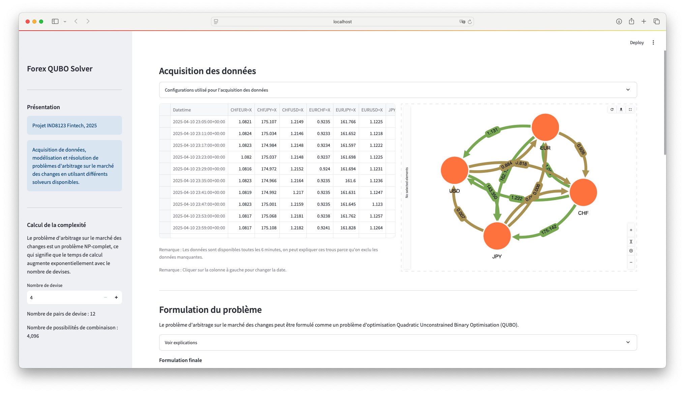
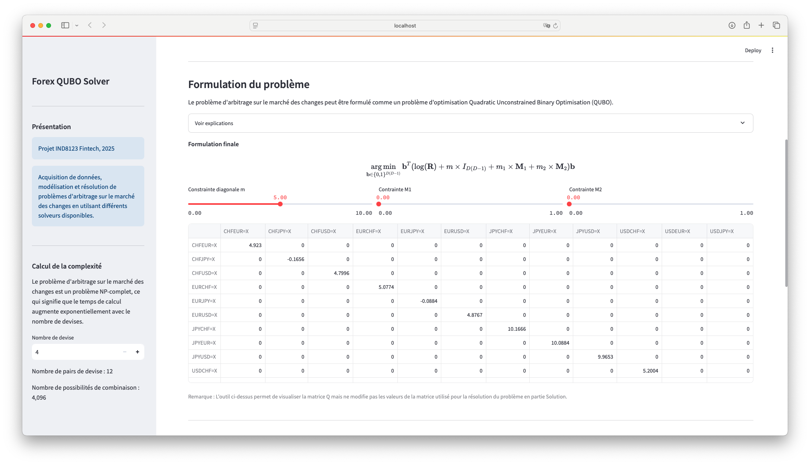
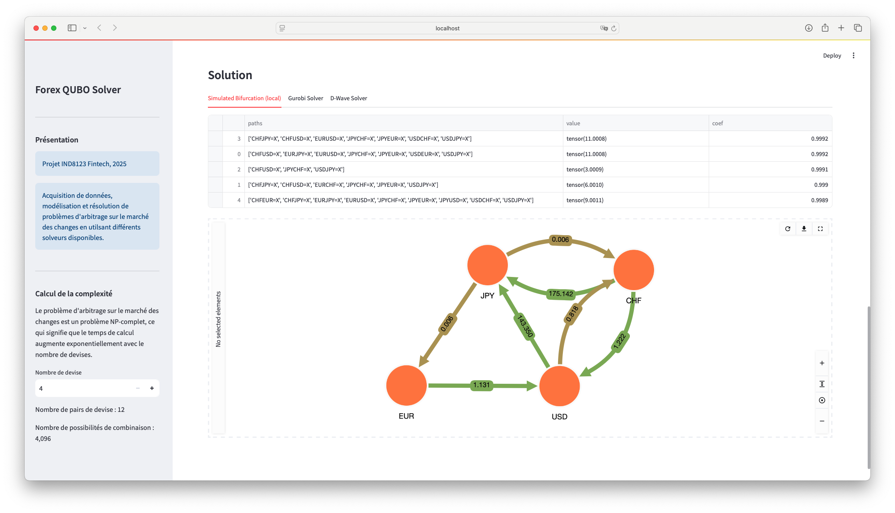

# Forex Arbitrage Detector

[Accéder à la démo Streamlit](https://forex-arbitrage.streamlit.app)

## Présentation

Ce projet vise à détecter et analyser les opportunités d'arbitrage sur le marché des changes (Forex) en utilisant une formulation QUBO (Quadratic Unconstrained Binary Optimization). Il permet de modéliser le problème d'arbitrage comme un problème d'optimisation combinatoire, résolu à l'aide de solveurs classiques ou quantiques.

Projet réalisé dans le cadre du cours IND8123 Fintech (2025).

## Fonctionnalités principales

- **Acquisition de données Forex** : Téléchargement et traitement des prix de devises depuis Yahoo Finance.
- **Formulation QUBO** : Modélisation du problème d'arbitrage sous forme de QUBO.
- **Résolution** : Utilisation de différents solveurs pour trouver des cycles d'arbitrage.
- **Visualisation** : Interface Streamlit interactive pour explorer les données, visualiser les graphes de devises et les cycles d'arbitrage.
- **Analyse de complexité** : Calcul du nombre de combinaisons et de la difficulté du problème selon le nombre de devises.

## Structure du projet

```
forex-arbitrage/
├── app/                # Application Streamlit principale
├── data/               # Données téléchargées et générées pour chaque configuration de devises
├── test/               # Scripts de test et d'exemple pour chaque module
├── docs/               # Images et schémas illustrant les étapes du projet
├── src/                # Code source principal (dataloader, problem, solver, figure)
├── README.md           # Ce fichier de documentation
└── requirements.txt    # Dépendances Python nécessaires au projet
```

- `app/` : Contient le code de l'application Streamlit (voir app.py pour le point d'entrée principal).
- `data/` : Stocke les données de marché, les graphes générés et les résultats de résolution pour chaque nombre de devises.
- `test/` : Fournit des scripts pour tester chaque composant du projet (dataloader, figure, problem, solver).
- `docs/` : Regroupe les images d'acquisition, de formulation et de solution utilisées dans le README.
- `src/` : Regroupe le code source principal, organisé par fonctionnalité (chargement, formulation, résolution, visualisation).
- `requirements.txt` : Liste toutes les dépendances Python nécessaires à l'installation du projet.

### Diagramme général du flux de données



## Installation

1. **Cloner le dépôt**
   ```bash
   git clone https://github.com/Dvdzh/forex-arbitrage.git
   cd forex-arbitrage
   ```

2. **Installer les dépendances**
   ```bash
   pip install -r requirements.txt
   ```

3. **Lancer l'application Streamlit**
   ```bash
   streamlit run app/app.py
   ```

## Utilisation

- **Sélection du nombre de devises** : Ajustez le nombre de devises pour générer différentes instances du problème.
- **Exploration des données** : Visualisez les prix, les graphes de devises et les cycles d'arbitrage potentiels.
- **Formulation et résolution** : Lancez la formulation QUBO et résolvez le problème avec différents solveurs.

## Aperçu de l'application


*Visualisation de l'acquisition des données Forex.*


*Illustration de la formulation QUBO pour l'arbitrage.*


*Exemple de solution d'arbitrage détectée par l'application.*

## Roadmap

- Refactoring du code et modularisation
- Ajout de nouveaux solveurs (quantiques et classiques)
- Backtesting et analyse de performance
- Documentation et tests automatisés
- Déploiement en ligne et conteneurisation

---